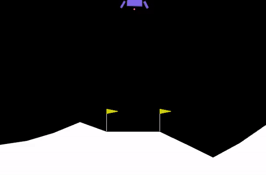

# Lunar Landing Agent: Deep Reinforcement Learning

[](https://huggingface.co/WaMp96/PPO-LunarLander-v3)

This repository documents my first project in deep reinforcement learning (RL), where I trained an autonomous agent to master the classic **LunarLander-v3** environment from Gymnasium. 

I undertook this project as a foundational milestone to gain hands-on experience with policy-gradient methods, reward shaping dynamics, and actor-critic architectures. Moving forward, I plan to expand on this foundation with further implementations exploring off-policy algorithms, continuous control tasks, and multi-agent systems.

---

## Agent Demonstration

<p align="center">
  
</p>

### How the Lander Operates Under the Reward System

The recording above captures 5 consecutive evaluation rollouts executed by the trained PPO policy. In this demonstration, the agent visibly navigates the mathematical trade-offs built into the environment's reward function:

1. **Trajectory & Target Alignment ($x \to 0$, $y \to 0$):**
   - The agent is rewarded positively for reducing its distance to the landing pad located between the two flags. Upon spawning at the top of the frame with randomized initial momentum, it immediately identifies the target coordinates and maneuvers laterally toward the center.
2. **Attitude Stabilization via Lateral Thrusters:**
   - Tilting excessively or rotating rapidly is heavily penalized. The policy uses short, calculated bursts of the left and right thrusters (costing only $-0.03$ points per frame) to cancel angular velocity ($\omega$) and keep the craft upright.
3. **Controlled Descent & Fuel Economy:**
   - Gravity naturally accelerates the craft downwards. While firing the main engine costs $-0.30$ points per frame in fuel, crashing imposes a severe $-100$ penalty. The agent avoids firing the engine continuously; instead, it uses pulsed throttle bursts to arrest downward velocity ($v_y$) just in time as it approaches ground level.
4. **Soft Touchdown & Engine Cutoff:**
   - Each leg touching the surface yields $+10$ points, and coming to a complete, stable rest awards $+100$ bonus points. As soon as both legs make contact, the agent cuts the engine to prevent bouncing or flipping, consistently securing episode returns between **$+233$** and **$+279$**.

*(The original video recording is also tracked in the repository as [lunarlander_attempts.mp4](lunarlander_attempts.mp4))*

---

## Environment Overview

The **LunarLander-v3** environment (Box2D physics engine) simulates the landing of a lunar module onto a designated landing pad:

- **State Space (8 Dimensions):** Continuous observations consisting of:
  - Horizontal coordinate ($x$) and vertical coordinate ($y$)
  - Horizontal velocity ($v_x$) and vertical velocity ($v_y$)
  - Lander orientation angle ($\theta$) and angular velocity ($\omega$)
  - Left leg ground contact boolean ($0$ or $1$)
  - Right leg ground contact boolean ($0$ or $1$)
- **Action Space (Discrete — 4 Actions):**
  - `0`: Do nothing
  - `1`: Fire left orientation engine
  - `2`: Fire main engine
  - `3`: Fire right orientation engine
- **Goal & Reward Mechanism:** The agent receives reward signals for moving toward the landing pad, zeroing velocity upon touchdown, and keeping the craft upright, with severe penalties applied for crashing or firing the main engine unnecessarily. Achieving an average score of $\ge +200$ points over consecutive episodes signifies that the environment has been successfully solved.

---

## Methodology & Architecture

I selected **Proximal Policy Optimization (PPO)**, an on-policy policy gradient algorithm developed by OpenAI, known for its balance of sample efficiency, stability, and ease of tuning.

- **Policy Model:** `MlpPolicy` (Multi-Layer Perceptron actor-critic architecture with shared/dedicated feature extractors).
- **Surrogate Objective:** Clipped objective function to restrict large policy updates and prevent performance degradation.
- **Advantage Estimation:** Generalized Advantage Estimation (GAE) to balance the bias-variance trade-off in value estimation.

### Key Hyperparameters

| Hyperparameter | Value | Description |
|---|---|---|
| **Algorithm** | PPO | Proximal Policy Optimization |
| **Policy** | `MlpPolicy` | Multi-Layer Perceptron Actor-Critic |
| **Total Timesteps** | `1,000,000` | Full training steps across environment iterations |
| **Rollout Steps (`n_steps`)** | `1024` | Steps per environment rollout buffer before update |
| **Batch Size** | `64` | Minibatch size during SGD optimization |
| **Epochs (`n_epochs`)** | `4` | Number of optimization passes over rollout buffer |
| **Discount Factor ($\gamma$)** | `0.999` | Long-term reward discount rate |
| **GAE Parameter ($\lambda$)** | `0.98` | Bias vs. variance factor for advantage estimation |
| **Entropy Coefficient (`ent_coef`)** | `0.01` | Exploration bonus weight |
| **Learning Rate** | `0.0003` | Adam optimizer learning rate |

---

## Evaluation & Results

Following training over 1,000,000 timesteps, I evaluated the model deterministically across 10 evaluation episodes using `stable_baselines3.common.evaluation.evaluate_policy`:

$$\text{Mean Reward} = \mathbf{247.00 \pm 19.15}$$

Because the environment standard benchmark considers an average return $\ge +200$ as "solved", the agent consistently and reliably executes soft, upright landings between the flags with minimal fuel waste.

### Sample Test Episodes

| Episode | Return | Outcome |
|:---:|:---:|:---|
| **Episode 1** | `+279.60` | Perfect soft landing |
| **Episode 2** | `+261.47` | Centered touchdown |
| **Episode 3** | `+233.62` | Upright touchdown |
| **Episode 4** | `+270.94` | Controlled descent & soft landing |
| **Episode 5** | `+271.39` | Stable landing |

---

## Tech Stack & Dependencies

- **Language:** Python 3.10+
- **Reinforcement Learning Framework:** [Stable-Baselines3](https://github.com/DLR-RM/stable-baselines3) (`stable-baselines3>=2.0`)
- **Environment:** [Gymnasium](https://gymnasium.farama.org/) (`gymnasium[box2d]>=1.0`)
- **Deep Learning Backend:** [PyTorch](https://pytorch.org/) (`torch>=2.0`)
- **Visualization & Recording:** `pyvirtualdisplay`, `imageio`, `ffmpeg`, `pygame`

### Installation

To run this notebook locally or in Google Colab:

```bash
# System dependencies (Linux / Colab)
sudo apt-get update
sudo apt-get install -y swig cmake ffmpeg xvfb python3-opengl

# Python dependencies
pip install "gymnasium[box2d]" stable-baselines3 huggingface-sb3 pyvirtualdisplay imageio
```

---

